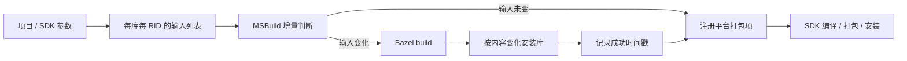

# 原生构建

六个平台入口只导入 `NativeBuild.targets`，共同使用 `build.py`、`.bazelrc`、`.bazelversion`。
Worldline 和 GAME 的源码与 Bazel 依赖分别位于各自目录；冻结的 `upstream_cpp` 不修改。

## 参数来源

- 项目的 TFM、`RuntimeIdentifier(s)`、`Configuration` 和 SDK 解析结果决定构建目标。
- 共同的 C/C++ 编译选项放在 `.bazelrc`，沿用原有的优化构建，Debug/Release 共用算法与浮点选项。
- Android NDK 版本由 `android-ndk-version.txt` 指定。SDK 解析安装根目录，两个库使用同一路径。
- iOS、Browser 的静态工具链使用项目所选的系统 SDK 或 .NET 工作负载，最低系统版本与 WASM 特性跟随项目。
- Python 读取 MSBuild 生成的 `.inputs` 文件，不另设 RID、SDK 路径或编译开关默认值。

## 构建与增量



SDK 内层和 Install 使用相同输入时，不启动 Python 或 Bazel。原生产物位于
`artifacts/native/<RID>/`；Debug/Release 共用原生库，Bazel 工作副本和对象缓存保留在 `artifacts` 下。
时间戳只表示输入已成功处理；手工修改或删除生成产物后使用 Clean/Rebuild。
Clean/Rebuild 会使原生成功记录失效，Bazel 仍能复用已有对象缓存。

正常构建只执行 Bazel `build`，不运行 `cquery/aquery/info`、许可证收集或来源清单生成。
同 RID 的工作副本写入由进程锁串行保护，未变化的库不重写。

## 使用

所有平台需要 Python 3.10+、Bazelisk 和相应 C/C++ 工具链。Windows 使用 VS C++ 工具，
GAME 的 Windows ARM64 使用 ClangCL；Linux 使用系统编译器，Apple 平台使用 Xcode，Android 使用 NDK。
安装环境后，在 Rider 选择入口项目和设备，或运行普通命令：

```powershell
$env:AVALONIA_TELEMETRY_OPTOUT='1'
dotnet build OpenUtauMobile.Windows/OpenUtauMobile.Windows.csproj
dotnet build OpenUtauMobile.Android/OpenUtauMobile.Android.csproj -r android-x64
```

跨架构时只在最上层选择一次 RID；未选择时 Android 使用 SDK 的默认集合，桌面使用入口 OS 与当前架构。
配置 SDK/JDK 的安装环境或 IDE 设置即可，不需要重复传递原生库专用路径和编译参数。

已有上游测试保留为手动操作。先生成对应 `.inputs`，再运行：

```powershell
python native/build.py artifacts/native/win-x64/worldline.inputs --test
python native/build.py artifacts/native/win-x64/game.inputs --test
```

GAME 默认选择无需外部模型和参考数据的既有测试。维护依赖时使用同一入口的 `--update-lock`，
审查并提交对应库目录的 `MODULE.bazel.lock`。
